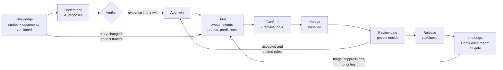
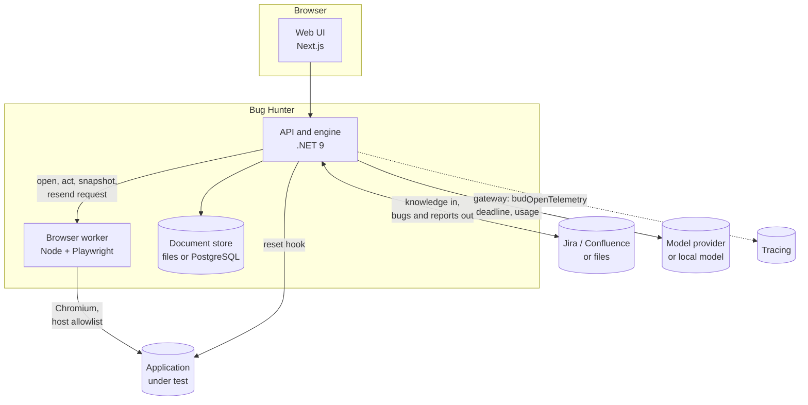

# Autonomous Bug Hunter for Web

[](https://github.com/abulslab/Autonomous-Bug-Hunter-Web/actions/workflows/ci.yml)
[](LICENSE)
[](docker-compose.yml)

**A continuous quality-engineering system for web applications.** It learns what an application should do from the
team's stories and documents, explores it in a real browser, reports only findings it can reproduce without AI, remembers every run,
and turns each release into a decision backed by evidence.

The web is its first execution surface. The core (knowledge, the app twin, rules and predictions, confirmation,
runs, review, readiness) does not depend on the browser; the browser sits behind a port, so other app types can plug
in their own driver ([ADR 0011](docs/adr/0011-the-execution-surface-is-a-port.md)).

> **AI proposes, the engine verifies.**
> Models decide what is worth exploring and what should be true. Deterministic code decides what is a bug, on recorded
> evidence, and replays it with no model in the loop. A model's opinion never becomes a finding by itself.

---

## The problem

Most QE organisations live with the same three gaps, sprint after sprint:

| Gap | What it costs a team |
|---|---|
| **The test-oracle problem.** Automated checks assert what the application does today, so today's bugs become tomorrow's expected results. | Bugs that pass every test; expectations nobody can trace back to a requirement. |
| **Unprovable findings.** AI testing agents say "this looks wrong" and leave a person to work out whether it is. | Triage time, eroded trust, findings that cannot be reproduced. |
| **No memory between runs.** Exploration starts from zero every time and cannot say what changed since the last release. | Retesting everything; regressions in areas no story touched; release calls made on instinct. |

Autonomous Bug Hunter is built to close all three, and to fit the way a QE team already works: stories in Jira,
documents in Confluence, a pipeline that gates releases, people who decide.

## Key capabilities

| Capability | What it does |
|---|---|
| **Expectations from intent** | Syncs stories and documents (Jira and Confluence, or files) as versioned knowledge; a model compiles them into rules in a small checkable language; a verifier keeps only what the observed application supports. |
| **A living model of the application** | An app twin, versioned with every run: pages, routes, endpoints by role, entities, features, lifecycles and rules, each marked declared, observed, inferred, verified or accepted, with its evidence. Built from OpenAPI, HAR and what hunts record. |
| **Exploration in a real browser** | A no-AI sweep maps the app; a planner turns the map, stories and domain skill packs into intents; a navigator follows known routes; engine probes resend recorded API calls with boundary values, other roles' sessions and disallowed transitions. |
| **Predictions without a model** | The twin predicts what must hold (a role's protected area answers nobody else; a lifecycle moves only from allowed states; an item is charged at its listed price) and checks every response against it. |
| **Proof before reporting** | Every finding is replayed twice in fresh sessions with no AI. Confirmed repros are shrunk by delta debugging and exported as Playwright tests, SARIF and JUnit. |
| **Regression journeys** | Happy paths are mined from what hunts actually did and count only once two model-free replays reach the same business outcome; proven journeys become the regression suite. |
| **Runs and baselines** | Each run is compared with an accepted baseline: new, fixed, still open, not retested, regressed, recovered, and behaviour that changed with or without a story to explain it. |
| **Change-driven testing** | A story change is traced to the features, rules, endpoints and journeys it touches; its rules are rewritten, its journeys proven again, and the change is hunted first. |
| **A review gate** | AI-drafted rules, proven journeys, unexplained behaviour changes and baseline updates wait for a person. An LLM judge from another model family advises, and may decide only once its measured agreement with people is high enough. |
| **Learning across runs** | Triage outcomes (bug, not a bug, known issue, won't fix) follow each bug by root cause: suppressions, priorities, a reusable rule library, retired rules. |
| **Release readiness** | A ready, at-risk or not-ready verdict computed from proven evidence over every run since the baseline, gated in CI, published to Confluence, with bugs filed in Jira and linked to the stories they break. |
| **Model-agnostic, AI-optional** | Bring your own key or a local model; one gateway enforces a budget and deadline on every call; every stage has a no-AI path, and hunts continue without AI when a provider fails. |

## How it works



1. **Ground.** Stories and documents are synced and versioned; a change is diffed criterion by criterion.
2. **Understand.** A model proposes entities, features, lifecycles and rules; the verifier keeps what the twin's
   evidence supports and records every refusal with its reason.
3. **Hunt.** The engine explores, attacks risky flows and checks every response with oracles, rules and predictions.
4. **Prove.** Findings are replayed twice without AI; only reproducible ones are confirmed, shrunk and exported.
5. **Compare.** The run is set against the baseline; a bug is "fixed" only if the run went back to where it showed.
6. **Decide.** People review what AI drafted and what changed; the readiness verdict follows from the evidence.
7. **Feed back.** Decisions, triage and story changes shape the next run.

## Architecture



| Layer | Responsibility | Key design choice |
|---|---|---|
| Knowledge (`Projects/`) | Projects, environments, roles, versioned stories and documents | Ports for Jira, Confluence and files; simulators with the real REST shapes in `src/Simulators` |
| App twin (`Twin/`) | Versioned model of the application, AI understanding, the verifier, predictions | Every item says how it is known; only observed or verified items ground a finding |
| Hunt engine (`Hunter/`) | Sweep, planner and driver, navigator, routines, probes, oracles, rules | Rules are a small three-valued language, checked on recorded traffic, never executed as code |
| Confirmation (`Hunter/Replay.cs`) | Model-free replays, shrinking, Playwright specs | A finding counts only if it reproduces twice in fresh sessions |
| Journeys and runs (`Journeys/`, `Runs/`) | Regression journeys, run snapshots, baselines, comparisons | "Fixed" requires a retest where the bug showed; otherwise "not retested" |
| Review and learning (`Review/`, `Learning/`) | Review gate and LLM judge, impact of changes, triage, suppressions, priorities | Observed behaviour never becomes an expectation without a person |
| Workflow (`Workflow/`) | Readiness verdict, Jira filing, Confluence publishing, CI gate | The verdict is a pure function of proven state, with no model involved |
| Browser worker (`src/browser-worker`) | Isolated Chromium sessions, live stream, recording | Untrusted and heavy: separate process, own allowlist, never holds model keys |

Eleven architecture decision records explain the choices and the evidence behind them, from
[ADR 0001: the AI never decides what is a bug](docs/adr/0001-ai-proposes-engine-verifies.md) to
[ADR 0010: readiness from proven evidence](docs/adr/0010-release-readiness-from-proven-evidence.md). The full design,
with trust boundaries and failure modes, is in [docs/architecture.md](docs/architecture.md).

## System thinking

The value is in the loops, not in any single hunt:

- **Intent flows forward, evidence flows back.** Stories become rules; observations become twin versions; neither is
  allowed to impersonate the other. A behaviour change no story explains is a review signal, never an expectation and
  never a bug by itself.
- **Trust is earned and measured.** A model's proposal passes a verifier, then replay, then review. The LLM judge has
  to show agreement with people before it may decide, and never decides on behaviour changes or blocking updates.
- **Change narrows the work.** Traceability from story to feature, endpoint, rule and journey tells each run what to
  test first; triage tells it what to stop flagging and where real bugs cluster.
- **Degradation is designed in.** No model, a slow model or a rate-limited model all lead to the same place: the
  engine keeps exploring, probing and proving, and says what it could not do.
- **The release question is answered honestly.** Coverage counts only accepted rules and proven journeys; one leaked
  area is one bug however many endpoints show it; a bug from the last release that nobody retested stays open.

## Benefits

| For | What changes |
|---|---|
| **QE leads** | A release verdict with its reasons, "what changed since the last release" as the first page of every run, and a review queue instead of a pile of unverified alerts. |
| **Developers** | Bugs that reproduce, with the recorded request and response, minimal steps and a Playwright test to run locally; one issue per bug, linked to the story it breaks. |
| **Product owners** | Every expectation traces to a story; changing a story changes what is tested next; the report says which stories are covered and by what. |
| **Engineering leadership** | Quality decisions backed by evidence; AI used where it adds reach, with people in control of what it is trusted with; no lock-in to one model or vendor. |
| **The platform team** | Runs in CI and on Docker, with an optional PostgreSQL store and OpenTelemetry tracing; integrations behind ports; skill packs and rules as reviewable files. |

## Why it is different

| | Typical record-and-assert automation | Typical AI testing agents | Autonomous Bug Hunter |
|---|---|---|---|
| Who decides a bug | The assertion someone wrote | The model | A deterministic oracle, rule or prediction, on recorded evidence |
| Where expectations come from | Current behaviour | The model's guess | Stories and documents, compiled into checkable rules and reviewed |
| Proof | Pass or fail | A text explanation | Two model-free replays, minimal steps, a Playwright test |
| Memory across releases | Scripts to maintain | Little or none | A versioned app twin, journeys, runs, baselines and decisions |
| What changed | Usually not answered | Usually not answered | Compared with an accepted baseline, retest-aware, story-aware |
| Release decision | Test pass rate | Usually not answered | A verdict from proven evidence, gated in CI |
| Dependence on AI | None | Total | Optional: every stage has a no-AI path |

### What makes the difference, in depth

**1. The verdict is separated from the reasoning.** Many AI testing tools ask a model whether something is a bug.
Here a model can only *propose*: an intent to try, a rule to check, a probe value. What counts as a bug is decided by
deterministic code (oracles for generic failures, rules in a small expression language, predictions from the app
twin) evaluated on recorded HTTP traffic. A rule is parsed, checked against the fields the application really returns,
and evaluated as data, never executed as code. *Why it matters:* the failure mode of a wrong model is a rule that does
not fire or is refused by the verifier, not a false bug in a developer's queue. ([ADR 0001](docs/adr/0001-ai-proposes-engine-verifies.md), [ADR 0002](docs/adr/0002-rules-in-a-checkable-language.md))

**2. It solves the test-oracle problem at the source.** Record-and-assert tests learn expectations from the
application, so they lock bugs in. Bug Hunter takes expectations only from intent: stories and documents, the roles a
project declares, and the lifecycles and consistency the twin infers and verifies. What the application happens to do
is recorded as evidence and compared run to run, but it becomes an expectation only when a person accepts it.
*Why it matters:* a regression in a field no test asserted still shows up, as an unexplained behaviour change.

**3. Every finding carries its own proof.** A finding is confirmed only after two replays in fresh browser sessions,
after the test-data reset and with no model, reproduce it. The repro is then shrunk by delta debugging to the fewest
user actions that still trigger it and written out as a Playwright test that runs without Bug Hunter.
*Why it matters:* developers receive something they can run, not something they have to believe.
([ADR 0004](docs/adr/0004-replay-before-reporting.md))

**4. It has memory, and the memory is versioned.** A project keeps knowledge versions, app-twin versions, a journey
library, runs with snapshots, an accepted baseline, review decisions and triage outcomes. Each twin item states how it
is known (declared by a specification, observed, inferred by a model, verified, accepted by a person) and the evidence
behind it. *Why it matters:* each run starts from what the last one learned, and "what changed since the last
release" has an exact answer.

**5. It reasons about change the way a QE lead does.** A story edit is diffed criterion by criterion and traced to
the features, rules, endpoints and journeys that depend on it. Its rules go stale until rewritten from the new
criteria and accepted again; its journeys are proven again; the change-driven hunt goes there first. A bug that
disappeared from a run that never went back to where it showed is reported as *not retested*, not as fixed.
*Why it matters:* regression effort follows risk, and a smaller run cannot quietly close a bug.

**6. It tests intent across roles and states, not only screens.** Role-only areas, entity lifecycles and listed
prices become predictions checked on every response; engine probes resend recorded calls with another role's
session, a disallowed transition or a boundary value. Seeded business-rule defects in the hotel demo (a front desk
open to guests, a quoted rate that differs from the charge) are found this way with no AI at hunt time.
*Why it matters:* the bugs that hurt a business are rarely crashes; they are rules quietly broken.

**7. People stay in charge of trust, and trust is measured.** AI-drafted rules, proven journeys, unexplained
behaviour changes and baseline updates go through a review gate; every decision is logged and reversible. An LLM
judge can take over routine decisions only when it is a different model family from the one that drafted the
proposal and its measured agreement with people is above a threshold, and a sample of its decisions goes back to a
person. *Why it matters:* automation scales the review without turning it into a rubber stamp.
([ADR 0009](docs/adr/0009-review-gate-and-llm-judge.md))

**8. The release decision is computed, not written.** The readiness verdict is a pure function of proven state over
every run since the baseline: confirmed bugs grouped by root cause, regressed journeys, blocking reviews, untested
changes, and coverage that counts only accepted rules and proven journeys. No model writes the report, so it can be
audited line by line, gated in CI and published as-is. ([ADR 0010](docs/adr/0010-release-readiness-from-proven-evidence.md))

**9. It meets the team where it works.** Knowledge comes from Jira and Confluence; bugs go back to Jira, one per root
cause and linked to the story they break; the readiness report is a versioned Confluence page; the gate is a CLI and
a GitHub Action; results are SARIF and JUnit. Integrations sit behind ports, with simulators for development.

**10. AI is optional, swappable and bounded.** Any provider or a local model sits behind one gateway with a budget,
a deadline and usage accounting on every call. When a model is slow, rate-limited or absent, the hunt continues with
the no-AI explorer and probes and records what it could not do. *Why it matters:* the system is useful on day one
without AI, gets more reach with it, and is not tied to one vendor.

## Evidence

What is claimed here is measured against ground truth in this repository; it has not yet been measured on a large
production application. Two demo applications ship with switchable seeded
defects, answer keys and multi-sprint scenarios ([ground-truth/](ground-truth/)):

- **Demo shop** (`src/DemoShop`): e-commerce, shoppers and staff, ten seeded defects.
- **Demo Hotel** (`src/DemoHotel`): bookings, guests and a front desk, eight seeded business-rule defects that no
  generic oracle can catch; only rules from the stories, roles and cross-page checks find them.

Every configuration is measured twice: with every defect on (what it finds) and with every defect off (any proven
finding is a false positive). Results depend on the model a team brings, so the harness reports configurations by
strategy, not by model; run it with yours ([docs/BENCHMARKS.md](docs/BENCHMARKS.md), [docs/evaluation.md](docs/evaluation.md)).

**A reference run** ([docs/reference-run.md](docs/reference-run.md)) takes Demo Hotel through two sprints from an
empty store: a story changes, a new feature ships with a bug, an unrelated area regresses, an old bug is fixed.

| | Sprint 1 | Sprint 2 |
|---|---|---|
| What the system did | Synced 6 stories and 3 documents, declared 10 endpoints from the OpenAPI document, understood the app (entities, features, the booking lifecycle, rules from five stories), surveyed both roles, hunted, replayed, filed bugs and published the report | Detected the story change criterion by criterion, traced it to the feature, endpoint, rule and journey it touches, rewrote the rules and hunted the change first |
| Seeded defects found and confirmed by replay | 3 of 3 | 3 of 4, including the regression no story touched (found by a twin prediction, no AI at hunt time); the new feature's bug was missed |
| Verdict | Not ready | Not ready |

The same run was a test of Bug Hunter itself. It exposed eight defects in the system (among them a rule-language
ambiguity that let a wrong AI rule reproduce as a "bug", a readiness report that looked only at the latest run, and a
smaller run that could count unvisited bugs as fixed). Each one is fixed and unit-tested, and the re-run showed no
rule false positives in either sprint. What is still open is listed there too.


## Quick start

### Setup: keys stay on your machine

The repository holds no keys or passwords. Everything the stack needs locally lives in a git-ignored `.env` at the
repository root:

| Variable | What it is | Where it comes from |
|---|---|---|
| `DEMO_SHOP_KEY` | Admin and test-reset key of the demo apps; the simulators' harness key | Generated on first run |
| `SIM_TOKEN` | API token of the Jira and Confluence simulators | Generated on first run |
| `GEMINI_API_KEY`, `ANTHROPIC_API_KEY`, `OPENAI_API_KEY` | Model providers, for AI strategies only | Your own key, optional |
| `BUGHUNTER_API_KEY` | Protects the API; required before anyone else can reach it | You choose it |
| `POSTGRES_PASSWORD` | Database password, only with the PostgreSQL store | You choose it |

`node scripts/dev.mjs` creates `.env` with random `DEMO_SHOP_KEY` and `SIM_TOKEN` values the first time it runs;
`node scripts/env.mjs` does the same without starting anything. To set values yourself, copy
[.env.example](.env.example) to `.env`. Never commit `.env`.

### Local

Requirements: .NET 9 SDK and Node 20+.

```bash
npm --prefix src/web install
npm --prefix src/browser-worker install
node scripts/dev.mjs
```

### Docker

```bash
node scripts/env.mjs          # creates .env with local keys (or copy .env.example to .env and fill it in)
docker compose up --build
```

Compose reads `.env` and refuses to start without the two local keys. Every port is published on `127.0.0.1` only:

- Web UI: http://localhost:3100
- API and OpenAPI reference: http://localhost:5280/docs
- Demo shop and Demo Hotel: http://localhost:5290, http://localhost:5291
- Jira and Confluence simulators: http://localhost:5292

### First run

Open **Projects → Demo hotel**, sync its knowledge from the simulated Jira and Confluence, and survey every role,
with no AI needed. The demo apps are fictional and sign in with demo accounts that are part of the demo data (shown
on their sign-in pages and in `ground-truth/`); they are not credentials for anything real.

For AI strategies, add a provider key to `.env`, or point the API at a local Ollama model. **Settings** can also hold
provider keys in memory for a running instance, from this machine only unless the API has an API key. With no Gemini
key, the API falls back to Google application default credentials if the machine has them, and those calls are billed
to that Google Cloud project.

> **The defaults are for local development.** The API has no API key and allows private network targets, so it can
> test the demo apps. Before anyone else can reach it: set `BUGHUNTER_API_KEY`, use fresh local keys, and turn off
> private targets. See [Running it beyond your own machine](docs/security.md#running-it-beyond-your-own-machine).

## In CI

```bash
node scripts/smoke-hunt.mjs                                              # a hunt that fails the build on confirmed findings
node scripts/ci-gate.mjs --project hotel --out readiness.md --publish    # hunt what changed, then the release verdict
node scripts/workflow-demo.mjs --app hotel                               # sprint 1, triage, sprint 2, release, end to end
```

As a GitHub Action:

```yaml
- name: Bug Hunter release gate
  uses: abulslab/Autonomous-Bug-Hunter-Web@main
  with:
    api-url: ${{ vars.BUGHUNTER_API }}
    api-key: ${{ secrets.BUGHUNTER_API_KEY }}
    project: hotel
    environment: staging
    publish: true
```

The gate syncs the stories, hunts what changed first, waits for the run, and fails the job when the release is **not
ready**: a confirmed bug open, a journey regressed, a blocking review undecided. Findings export as SARIF for code
scanning and JUnit for any test view. See [docs/examples/bug-hunter-gate.yml](docs/examples/bug-hunter-gate.yml).

## Security

Hunts stay on the target's host. Secrets are substituted inside the isolated browser worker: models see only
`{{secret:name}}`, and values are masked in screenshots, evidence, video and specs. Project secrets are write-only.
Irreversible actions are blocked outside test hosts. The demo apps' admin key stays on the server and is never
returned by the API. Optional API key, rate limiting on starting hunts, and private targets allowed only outside
Production. Only test applications you own or are permitted to test. See [docs/security.md](docs/security.md),
including how to report a vulnerability.

## Honest limits

- A wrong AI-written rule reproduces as faithfully as a real bug: replay proves a finding repeats, not that the
  expectation is right. That is what the review gate and the defects-off measurement are for.
- Probes reach the endpoints the UI or an imported specification exposed; journeys recorded through long UI paths can
  break when the UI changes.
- WebSockets, canvas-rendered UIs and interactive MFA are outside scope. Hunts do not resume after an API restart.

Details: [docs/limits.md](docs/limits.md).

## Repository

```
src/BugHunter.Api      .NET 9 API: projects, twin, hunt engine, replay, runs, review, learning, workflow, model gateway
src/browser-worker     Node + Playwright: isolated browser sessions, live stream, recording
src/web                Next.js UI
src/DemoShop           Ground-truth app: e-commerce, ten switchable seeded defects
src/DemoHotel          Ground-truth app: bookings, eight seeded business-rule defects
src/Simulators         Jira and Confluence simulators with the real REST shapes
ground-truth/          Answer keys, knowledge and multi-sprint scenarios for both demo apps
skills/                Skill packs: domain testing knowledge for the planner, in Markdown
scripts/               Dev launcher, CI gate, smoke hunt, benchmark harness, scenario runner, workflow demo
tests/                 xUnit unit and API tests
docs/                  Architecture, ADRs, evaluation, benchmarks, configuration, extending, security, limits
```

## Documentation

| | |
|---|---|
| [Architecture](docs/architecture.md) | The problem, the continuous QE loop, layers, trust boundaries and failure modes, containers, hunt sequence |
| [Decisions](docs/adr/) | Eleven ADRs, each with context, alternatives and evidence |
| [Reference run](docs/reference-run.md) | Two sprints end to end from an empty store: what was found, what was missed, what it taught |
| [Evaluation](docs/evaluation.md) and [Benchmarks](docs/BENCHMARKS.md) | Ground truth, metrics, threats to validity, how to reproduce |
| [Limits](docs/limits.md) | Protocols, state and replays, authentication, non-goals |
| [Configuration](docs/configuration.md) | Every setting |
| [Extending](docs/extending.md) | Rules, skill packs, oracles, routines, model providers, benchmark targets |
| [Security](docs/security.md) | Threat model and controls |
| [Roadmap](docs/roadmap.md) and [status report](docs/status-report.md) | What is done, what is next, every run including failures |

## Contributing

See [CONTRIBUTING.md](CONTRIBUTING.md). Licensed under the [MIT License](LICENSE).
