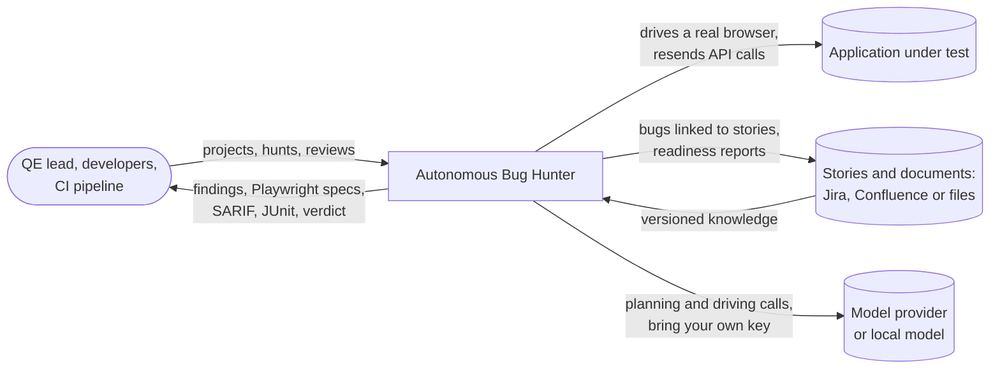
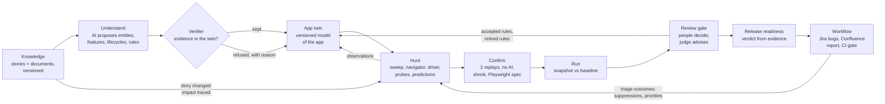
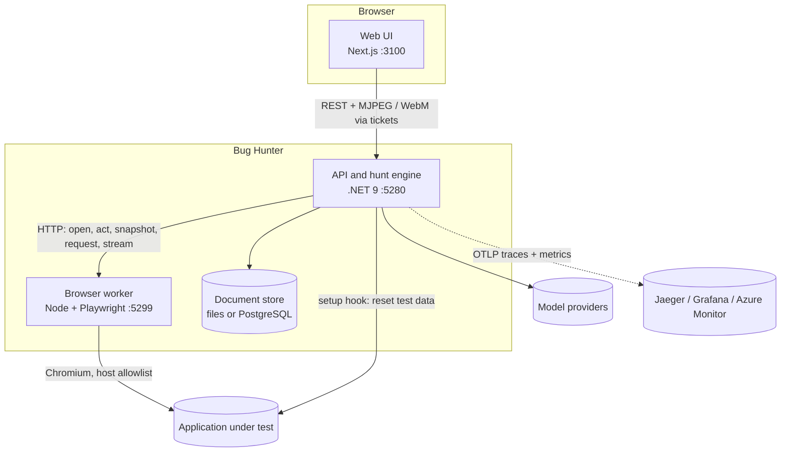
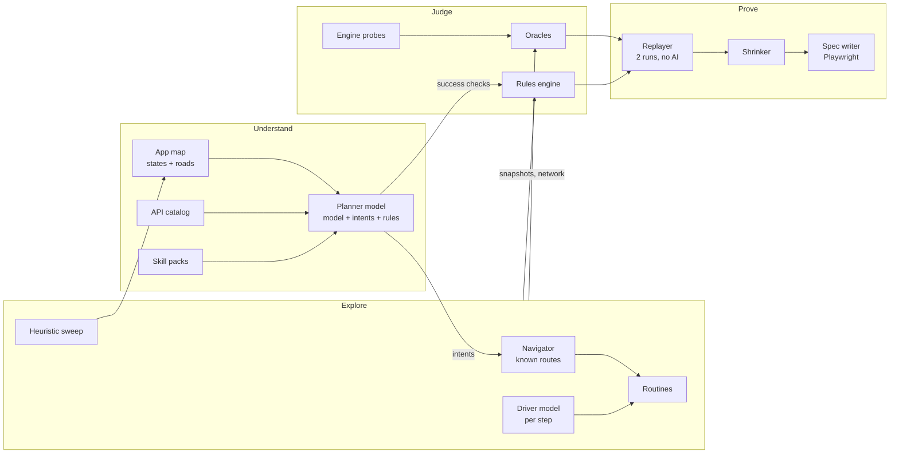
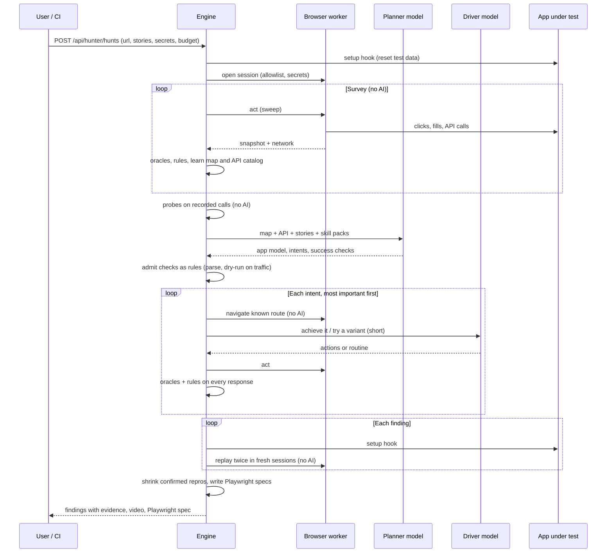

# Architecture

Autonomous Bug Hunter is a continuous quality-engineering system for web applications. It lives with an application
across releases: it learns what the application should do from the team's stories and documents, explores it in a
real browser, reports only findings it can reproduce without AI, and turns each run into a release decision. One principle shapes
every component: **the AI proposes, the engine verifies.** Models decide what is worth testing and what should be
true; deterministic code decides what is a bug, on recorded evidence, and replays it without any model.

## 1. The problem it is built for

Test automation and AI testing agents commonly share three failure modes that QE organisations pay for every sprint:

- **The test-oracle problem.** A test that asserts what the application does today locks today's bugs in. Expectations
  have to come from intent (stories, documents, roles), not from observed behaviour.
- **Unprovable findings.** A model that says "this looks wrong" produces triage work, not bugs. A finding is worth a
  developer's time only if it reproduces, without the model, with the evidence attached.
- **No memory between runs.** One-off exploration forgets what it learned, cannot say what changed since the last
  release, and retests everything instead of what a change touched.

The architecture answers each one: expectations are compiled from intent into checkable rules and predictions; every
finding is replayed twice with no AI before it counts; and a project keeps a versioned model of the application, its
journeys, its runs and its decisions, so each run is compared with an accepted baseline and starts from what changed.

## 2. System context

Everything outside the box is a port: knowledge sources and the issue and document writers (Jira and Confluence REST
shapes; `src/Simulators` stands in for both during development), model providers behind one gateway, and the
application, reached only through an isolated browser worker. The system runs with no model at all; models add
reach, never authority.

## 3. The continuous QE loop

Four feedback loops make it a system rather than a tool:

| Loop | What flows back | Effect on the next run |
|---|---|---|
| Knowledge -> twin | A story change, diffed criterion by criterion | Its rules go stale until rewritten and re-accepted; affected journeys are proven again; the change is hunted first |
| Review -> twin | Accepted, rejected and retired rules; journeys admitted to the gate; behaviour accepted as intended | Only reviewed expectations gate a release; a rejected rule is never proposed again |
| Triage -> hunt | Bug, not a bug, known issue, won't fix, per finding and root cause | Not-a-bug findings are suppressed; endpoints with real bugs become priorities in later missions |
| Run -> baseline | What changed: new, fixed, not retested, regressed, unexplained behaviour | A run with only improvements advances the baseline itself; anything else waits for a person |

## 4. Layers

**Projects and knowledge** (`Projects/`). Each application under test is a project: environments (URL and test-data
reset hook), roles with test accounts held as write-only secrets, and knowledge synced from Jira and Confluence or
files. A sync creates a new knowledge version only when something changed, and every hunt records the version of
each story it was grounded in.

**App twin** (`Twin/Twin.cs`). Every project hunt adds a version: pages, routes and endpoints with statuses by role,
each with its evidence and how it is known (declared by a specification, observed, inferred by a model, verified,
accepted by a reviewer). Only observed or verified items can ground a finding.

**AI understanding and the verifier** (`Twin/Understanding.cs`). A model is given the twin, the stories, the documents
and the skill packs and proposes entities, features, lifecycles and rules. A deterministic verifier keeps only what it
can tie to an endpoint, field, page, story or role in the twin, and records every refusal with its reason. A rule the
model writes again in other words replaces the earlier wording instead of being checked twice.

**Predictions** (`Twin/Predictions.cs`). Intent becomes checks on every recorded response: lifecycle transitions only
from allowed states, a role's protected area answering nobody else, an item charged at the price it is listed at.
Probes make them testable without a model. Observed behaviour never becomes a prediction.

**Hunt engine** (`Hunter/`). A no-AI sweep maps the application; the planner turns the map, stories and skill packs
into intents and rules; a navigator follows known routes and a driver model handles the last step; engine probes
resend recorded calls with risky changes. Oracles and rules judge every response. Rules are a small three-valued
language: a field the response lacks means "not applicable", never "failed"; `prev` is the same entity as it was last
seen, so lifecycle rules compare a booking with itself, not with the previous call to the endpoint.

**Confirmation** (`Hunter/Replay.cs`). Each finding is replayed twice in fresh sessions after the reset hook, with no
model; only findings that reproduce both times are confirmed. Confirmed repros are shrunk by delta debugging and
written out as Playwright tests.

**Journeys** (`Journeys/`). For each successful write a role reached, the path to it is mined from the hunt and proven
only when two model-free replays reach the same outcome. Proven journeys form the regression suite.

**Runs and baselines** (`Runs/Runs.cs`). The hunts started together form a run; its snapshot records proven findings
with where they show (endpoint and role), what the run exercised, journey statuses, endpoint behaviour, story versions
and coverage. Compared with the baseline: new, fixed, still open, **not retested** (gone, but the run never went
there, so not counted as fixed), regressed and recovered journeys, behaviour changed with or without a story to
explain it.

**Review gate** (`Review/`, ADR 0009). AI-drafted rules, proven journeys, unexplained behaviour changes and baseline
updates wait for a decision. People decide; every decision is logged and reversible. An LLM judge from another model
family gives advice, and may decide only once its measured agreement with people is high enough; behaviour changes
and blocking updates always need a person.

**Learning** (`Learning/`). Traceability from a story to its features, rules, endpoints and journeys gives the impact
of a change; the change-driven hunt tests it first. Triage outcomes are kept per finding and root cause (every
endpoint of one leaked area is one bug), feeding suppressions and priorities.

**Workflow and readiness** (`Workflow/`, ADR 0010). The verdict (ready, at risk, not ready) is a pure function of
proven state over **every run since the baseline**, not only the latest: open confirmed bugs grouped by root cause,
baseline bugs not retested (assumed still open), regressed journeys, blocking reviews, untested changes, coverage from
accepted rules and proven journeys only. It is served as JSON and Markdown, gated in CI and published to Confluence;
bugs are filed in Jira once per root cause and linked to the story they break.

The application under test is any web app the browser worker can reach. Two demo apps with switchable seeded defects
and answer keys serve as ground truth: the demo shop (`src/DemoShop`) and Demo Hotel (`src/DemoHotel`, whose
defects only requirement-derived rules can catch). See [evaluation.md](evaluation.md).

## 5. Trust boundaries and failure modes

| Boundary or failure | Design response |
|---|---|
| A model is wrong | It can only propose. The verifier refuses what the twin cannot support; rules are checked, not executed; a finding needs a deterministic check and two model-free replays; AI-written rules gate a release only after review |
| A wrong rule reproduces | Replay proves a finding repeats, not that the expectation is right. That is why rules pass the review gate, rules broken on most responses are flagged as probably wrong, and false positives are measured with every seeded defect off |
| A model is slow, rate-limited or absent | Calls go through one gateway with a budget and a deadline; after repeated failures the hunt continues without AI and says so. Every stage has a no-AI path |
| The browser is untrusted | It runs in a separate worker with a host allowlist; it never holds model keys; secrets are substituted inside it and masked in every artifact |
| Observed behaviour drifts | A change no story explains is a review signal, never an expectation and never a bug by itself |
| A run covers less than the last one | A bug that disappeared where the run never went is "not retested", not "fixed", and stays open in the release report |
| One bug, many symptoms | Findings share a root cause (a role reaching a protected area); readiness counts causes and Jira gets one issue |

## 6. Containers

| Container | Responsibility | Why separate |
|---|---|---|
| Web UI | Launch hunts, watch live, review findings, intents and benchmarks | Static client; no secrets |
| API and hunt engine | Strategy, oracles, rules, probes, replay, storage, model routing | One place owns every decision about what is a bug |
| Browser worker | Real Chromium sessions; snapshots, actions, request replay, live stream, recording | A browser is untrusted and heavy: isolated process, own allowlist, never holds model keys |
| Document store | Hunts, screenshots, app maps, projects, twins, runs, reviews | Interface with two backends: files (single node) and PostgreSQL (shared) |

## 7. Components of the hunt engine

| Component | File | Notes |
|---|---|---|
| Heuristic sweep | `Hunter/HuntPolicy.cs` (`HeuristicHuntPolicy`) | Forms, widgets and links by page template; boundary and invalid values; no AI |
| Driver / planner | `Hunter/HuntPolicy.cs` (`ModelHuntPolicy`) | One call path: budget, deadline, usage, cut-off detection; JSON contracts with one repair |
| App map, navigator | `Hunter/AppMap.cs`, `HuntEngine.cs` | States = page template + signed-in; roads = recorded action groups; cheapest route with reroute |
| API catalog, skill packs | `Hunter/Knowledge.cs`, `skills/*.md` | Endpoints and fields from traffic; domain knowledge chosen by keyword match |
| Oracles | `Hunter/Oracles.cs` | Money arithmetic, tax rounding, invalid input accepted, duplicate coupons, overselling, search misses, server and JS errors |
| Rules | `Hunter/Invariants.cs` | A small expression language; three-valued (a missing field means "not applicable", never "failed") |
| Engine probes | `Hunter/Probes.cs` | Recorded calls resent with boundary values, invalid formats, repeats, stock + 1, other case, no session |
| Replay and shrinking | `Hunter/Replay.cs` | Fresh sessions, elements re-found by role and name (numbers in labels ignored), delta debugging over user actions |
| Spec writer | `Hunter/SpecWriter.cs` | A Playwright test per finding, from the shrunk path, reusing the app's own request headers for API steps |
| Model gateway | `Models/Providers.cs` | Bring your own key: Google, Anthropic, OpenAI-compatible or a local Ollama model; budget, deadline and usage on every call; a cut-off reply is retried once with more room |

## 8. A Guided hunt, step by step

## 9. Architecture decisions

Each decision is recorded with its context and the evidence that drove it. See [`docs/adr/`](adr/).

| ADR | Decision |
|---|---|
| [0001](adr/0001-ai-proposes-engine-verifies.md) | The AI never decides what is a bug |
| [0002](adr/0002-rules-in-a-checkable-language.md) | AI-written expectations are rules in a small language, not code |
| [0003](adr/0003-probe-recorded-api-calls.md) | Probe the API calls the app really makes, through the browser session |
| [0004](adr/0004-replay-before-reporting.md) | Every finding is replayed without AI before it counts |
| [0005](adr/0005-planner-and-driver-models.md) | Two model roles: a planner for few calls, a driver for many |
| [0006](adr/0006-browser-in-an-isolated-worker.md) | The browser runs in an isolated worker process |
| [0007](adr/0007-document-store-behind-an-interface.md) | Storage is a document-store interface: files or PostgreSQL |
| [0008](adr/0008-map-before-reasoning.md) | Map the app before reasoning about it (warm-up, then intents) |
| [0009](adr/0009-review-gate-and-llm-judge.md) | A review gate, with an LLM judge that has to earn the right to decide |
| [0010](adr/0010-release-readiness-from-proven-evidence.md) | Release readiness is computed from proven evidence and written back to Jira and Confluence |
| [0011](adr/0011-the-execution-surface-is-a-port.md) | The execution surface is a port: the web is the first driver, the core does not depend on it |

## 10. Quality attributes

| Attribute | How it is met | Evidence |
|---|---|---|
| Correctness of findings | Deterministic oracles and rules; replay twice with no AI; review gate for AI-written rules | False positives measured with every seeded defect off ([BENCHMARKS.md](BENCHMARKS.md)) |
| Efficiency | Engine first; a planner for a few calls and a driver for short ones; a per-hunt AI budget; model calls counted per hunt; no-AI paths for every stage | Hunts report their model calls and switch to the no-AI explorer when the budget ends or the provider fails |
| Security | Host allowlist in the browser; secrets substituted in the worker and masked everywhere; irreversible actions blocked; SSRF guard; optional API key; rate limits | `docs/security.md` |
| Operability | `/healthz`, `/readyz`, OpenAPI at `/docs`, OpenTelemetry traces and metrics, Docker Compose, CI smoke hunt | `.github/workflows/ci.yml` |
| Extensibility | Skill packs as files; oracles, probes and model providers behind small interfaces | `docs/extending.md` |

## 11. Known limits

Measured on the two demo apps in this repository, not yet on a large production application. The main boundaries
(details in [limits.md](limits.md)):

- **Replay proves repetition, not correctness.** A wrong AI-written rule reproduces as faithfully as a real bug; rules
  broken on most responses are flagged, and AI-written rules count towards readiness only after review.
- **Test data must be resettable** for replays to be meaningful; plus-addressed test users are an opt-in alternative.
- **Scope:** requests made with `fetch` and `XMLHttpRequest`; pages with an accessibility tree; form sign-in with test
  accounts. Not streams, canvas-drawn interfaces or interactive multi-factor sign-in.
- **Probes** reach the endpoints the UI called or an imported specification declared.
- **Change-driven hunts** do not yet try new request fields; AI-drafted lifecycles are not reviewed yet; long UI
  journeys are brittle.
- **Hunts run inside the API process** and do not resume after a restart (secrets are held in memory by design).
