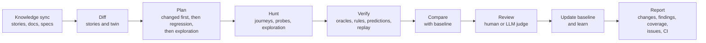

# Plan: from bug hunter to continuous QE system

Status: agreed 2026-04-11. P0 to P10 built; the combined end-to-end test and the full benchmark come next. During development each phase gets unit tests and one smoke
check; the full benchmark is measured once, after P10. Phases are built one at a time, P0 to P10; each phase ends finished, tested,
measured and documented before the next begins.

## 1. Goal

Bug Hunter becomes a QE system that lives with an application across sprints and releases, not a tool pointed at a URL
once. For each application it keeps a versioned **twin** (what the app contains, who can do what, and what it should
do), a library of **proven journeys**, a **baseline** of the last accepted run, and the **knowledge** it was grounded in.
On every run it tells the team what broke, what changed since the last run, and what a changed story affects, and it
publishes its own accuracy and false-positive rate.

## 2. Principles (each becomes or extends an ADR)

1. **AI proposes, the engine verifies**, everywhere: findings, rules, twin items, journeys, baseline updates.
2. **Expectations come from intent, never from observed behaviour.** Stories, grounding, specs, skills and the app's own
   consistency define what is correct. Observed behaviour grounds names and routes, and is a *change signal* only.
   Observed behaviour becomes expected behaviour only when a reviewer accepts it.
3. **Every item has evidence and a status**: declared (from a spec), observed (recorded), inferred (proposed by AI),
   verified (confirmed by the engine), accepted (approved by a reviewer). Only verified or accepted items can fail a build.
4. **Everything is traceable**: story → rule / journey / twin item → finding → issue, in both directions.
5. **Measured against ground truth**: every capability has a benchmark row before it is claimed.
6. **Costs fall over time**: verified knowledge replaces AI calls; the strong model builds, cheap models and the
   engine maintain.
7. **Standalone with adapters**: Bug Hunter runs on its own; external systems (Jira, Confluence, CI) sit behind ports.

## 3. Target architecture

### Bounded contexts

| Context | Owns | Key concepts |
|---|---|---|
| Projects | The application under test and its setup | Project, Environment, Role, SecretSet |
| Knowledge | Versioned inputs | GroundingDoc, SkillPack, Story (+ versions), Spec (OpenAPI, HAR) |
| Twin | What the app is and should do, per version | Surface, ApiCatalog, Entity, Lifecycle, Feature, Permission, Rule, Prediction, Unknown |
| Journeys | Happy paths and their proof | Journey, Step, SuccessCriterion, Proof |
| Hunting | Runs (existing engine) | Hunt, Step, Finding, Probe, Replay |
| Baselines | Comparison between runs | Baseline, RunComparison, ChangeSignal, Acceptance |
| Review | Human and LLM-judge decisions | ReviewItem, Decision, Judge, AgreementScore |
| Learning | What carries over | RuleLibrary, TriageOutcome, Suppression, Priority |
| Integrations | Ports and adapters | IStorySource, IDocSource, IIssueTracker, ICiTrigger |

### Ports and adapters

**P0 to P10 are built and tested against simulators only.** Real systems and real applications come afterwards, in
phase R, behind the same ports, so nothing built earlier changes.

| Port | Built and tested with (P0–P10) | Later (phase R) |
|---|---|---|
| Story source | Files in the repo (CI and README demo); the Jira simulator | Jira Cloud, Azure DevOps |
| Document source | Files; the Confluence simulator | Confluence |
| Issue tracker | The Jira simulator; GitHub Issues (exists) | Jira |
| CI trigger | Scripted (exists: smoke hunt); GitHub Actions against the demo apps | Webhooks from real deploys |
| Application under test | The demo apps (shop, hotel) | Real applications, starting with RealWorld "Conduit" |

**All simulators live in this repository**, in one app (`src/Simulators`), so development needs no other projects or
extra local services. It hosts:

- a **Jira simulator**: projects, epics, stories and bugs with acceptance criteria, workflow transitions, comments,
  labels and a change history per issue, exposing Jira Cloud's REST API shapes;
- a **Confluence simulator**: spaces, pages and page versions.

Both expose the same URL shapes and JSON as the real services' REST APIs (the subset Bug Hunter uses), so a phase R
adapter for real Jira or Confluence is the simulator adapter pointed at another base URL and credentials, and contract
tests can run against both. Scenario scripts (P0) drive the simulators to change stories and pages between runs.

### Run lifecycle (target)

## 4. Phases

Each phase lists what it delivers, how it is proven, and the ADRs it adds. "Done" for every phase also means: unit and
API tests, a benchmark row or scenario, UI where users need it, docs updated, CHANGELOG entry, pushed.

### P0. Ground truth for a continuous system (done)
- **Answer keys** per demo app (`ground-truth/<app>/answer-key.json`): roles, features, entities with fields,
  lifecycles, endpoints, permissions, rules, journeys, seeded defects, unseeded bugs and known oracle gaps.
- Demo apps grow: a **second role** in both apps (shop staff with an order desk; a hotel front desk, with guests scoped
  to their browser); an **OpenAPI document** served by both; new seeded defects of the kinds the twin targets
  (permission, lifecycle, cross-page consistency, and one inside a new feature).
- **Scenarios** for multi-run benchmarks (`ground-truth/<app>/scenarios/sprint-2.json`, applied by
  `scripts/scenario.mjs`): a story edited, a feature shipped with a bug in it, an unrelated regression, an earlier bug
  fixed; feature switches change the app's surface; stories are versioned.
- Proven by: tests that each answer key's endpoints equal the app's OpenAPI document, that roles, lifecycles, features
  and defects behave as specified, and that the scoring recognises each new defect; both scenarios applied to the
  running apps; the no-AI control re-measured (shop 6 of 9, hotel 0 of 7, no false positives on either).

### P1. Projects and knowledge (and the simulators) (done)
- **`src/Simulators`**: the Jira and Confluence simulators described in section 3, seeded with the demo apps' stories
  and grounding pages, with an admin hook to reset and to apply scenario changes.
- **One command for development**: `node scripts/dev.mjs` starts the API (which starts the browser worker), the web
  UI, both demo apps and the simulators; waits until each is healthy; prints one table of URLs; prefixes each
  process's log lines with its name; and stops everything on Ctrl+C. Options to start a subset (`--only api,shop`) and
  to skip the build. Docker Compose covers the same set for container runs. Node is already required, so it works the
  same on Windows, macOS and Linux.
- **Project**: environments (URL, reset hook), roles with secret sets, mission, out-of-scope areas.
- **Knowledge base**, versioned: grounding documents, skill packs (shared and project-specific), stories, specs.
  Bug Hunter saves the version of each story it tested against, so changes are detected even when the source keeps no
  history.
- **Story and document sources**: file adapters, and adapters for the Jira and Confluence simulators.
- Traceability IDs on everything later phases create.
- Hunts run inside a project; existing single-URL hunts keep working (an implicit project).
- Proven by: a story edited in the simulator is detected as changed on the next sync, with a criteria-level diff.
- ADR: projects and versioned knowledge; ports and adapters for external systems.

### P2. Twin foundation (no AI) (done)
- Twin schema with evidence and status for every item; stored per project, **versioned per run**.
- Observed layers from the engine: surface (states, roads), API catalog (endpoints, fields, statuses), per role.
- **App model page** in the UI: layers, evidence, statuses, unknowns, version history.
- Proven by: surface and API recall against the answer keys, with no model.
- ADR: the twin, evidence statuses and versioning.

### P3. More sources and roles (done)
- **OpenAPI and HAR import** into the API layer as declared items; declared-vs-observed differences reported
  (documented but unreachable, reachable but undocumented, schema drift).
- **Multi-role surveys**: one pass per role; a **permission matrix** (feature × role: allowed, denied, not seen).
- Proven by: permission matrix against the answer keys; the seeded permission defect visible as a matrix mismatch.

### P4. AI understanding with a verifier (done)
- The planner proposes entities, lifecycles, features and rules, each linked to evidence (pages, API fields, stories,
  grounding).
- A **verifier** admits, flags or rejects each proposal, as rules are admitted today; unverified items never produce
  findings.
- **Incremental updates**: later runs send only new or changed evidence to the model.
- Proven by: precision and recall of entities, features, lifecycles and rules against the answer keys; cost per twin
  build and per update.

### P5. Journeys (done)
- **Mined** from recorded trails that reached a business outcome (no AI); **composed** from the twin (AI);
  **derived** from stories (each acceptance criterion maps to at least one journey or rule).
- **Proof**: a journey counts only after it ran end to end without AI in a fresh session and its success criteria held.
- Journey library per project and role; a Playwright spec per journey; coverage per story, feature and role.
- Proven by: share of answer-key journeys proven 2 of 2; story coverage report.
- ADR: journeys as proven assets.

### P6. Predictive twin (done)
- Predictions in four kinds: field relations, lifecycle transitions, cross-endpoint consistency, permissions per role.
- A prediction engine checks every recorded response; mismatches are a new finding source, **Twin mismatch**, with the
  prediction and its source shown.
- **Cross-role replay**: calls recorded as one role are resent with another role's session (the order desk's API as
  a shopper), because a permission defect behind a link the UI hides is otherwise never exercised. Found in P3: the
  survey confirmed the hotel's open front desk, but the shop's open order desk stayed invisible to it.
- Intended predictions are bug oracles; observed baselines are change signals only (principle 2).
- Proven by: seeded defects caught by predictions; zero twin-mismatch findings with defects off; prediction precision.
- ADR: intent over observation.

### P7. Baselines and run comparison (done)
- **Baseline** per project and environment: the last accepted run's journey results, behaviour fingerprints per
  endpoint and journey, findings and their states, coverage.
- **Run comparison**: findings new, fixed, still open, reopened; journeys passing → failing (regressed) and failing →
  passing; behaviour changed without a story change; coverage gained or lost.
- **"What changed since the last run"** report: the first page of every run.
- Proven by: in the multi-run scenario, the planted regression is reported as regressed and the fixed bug as fixed.

### P8. Review gate and baseline updates (done)
- Review items: AI-drafted rules and journeys, twin items that would fail builds, behaviour changes to accept as
  intended, baseline updates.
- **Human review** in the UI, with an optional **LLM-as-judge bypass** per project:
  - the judge uses a different model family from the planner;
  - every judge decision is logged with its reasoning and can be reversed;
  - the judge is **benchmarked** against the answer keys and human decisions (agreement rate), and bypass is allowed
    only above a configured agreement threshold;
  - a sample of judge decisions is routed to a human for spot checks;
  - nothing that contradicts intent is auto-accepted by anyone.
- Baseline update policy: unchanged and passing items advance automatically; changes need acceptance.
- Proven by: judge agreement rate on the benchmark set; baseline updates audited end to end.
- ADR: review gate and LLM-as-judge.

### P9. Change-driven hunting and learning (done)
- **Story change** → traceability finds affected rules, journeys and twin items → rules rewritten from the new
  criteria, journeys re-proven, a targeted hunt on that area first.
- **App change** (twin diff) → new or changed areas explored first.
- **Learning loop**: rules that held across runs and survived review join the project's **rule library** and are reused
  without AI; rejected rules retire with their reason; triage outcomes (bug, not a bug, known issue, won't fix) feed the
  verifier and suppressions; what found real bugs on this app informs priorities.
- Proven by: in the multi-run scenario, the changed story is re-tested first and run 2 costs less than run 1 at equal or
  better recall, with no new false positives.

### P10. Workflow integration and release readiness (done)
- **CI trigger on deploy** (GitHub Actions example) running a change-aware hunt plus the journey regression suite;
  SARIF, JUnit and issues with dedupe (exist).
- **Issue tracker adapter** for the Jira simulator (findings filed as bugs, linked to the stories they break).
- **Release readiness report**: coverage per story, journeys passing, open confirmed bugs, changes since the last
  release, accepted behaviour changes.
- **Workflow demo**: sprint planning → deploy → triage → release, end to end on a demo app.
- Final benchmarks, ADRs, README and architecture updated.

### R. Real integrations and real applications (after P10)
- Adapters for Jira Cloud, Azure DevOps and Confluence behind the existing ports; contract tests run against both the
  simulators and the real services, so the simulators stay faithful.
- Real applications under test, starting with RealWorld "Conduit" (no seeded defects): false positives, scale and cost
  at realistic size.
- Hosted-model benchmark runs across configurations, if not done earlier.
- Proven by: the multi-run scenario repeated with real Jira and Confluence; false positives on Conduit.

## 5. The signature scorecard

| Measure | Phase |
|---|---|
| Twin accuracy (precision and recall per layer) vs answer keys | P2–P4 |
| Journeys proven vs answer keys; story coverage | P5 |
| Seeded defects confirmed, by source (oracle, rule, prediction) | P6 |
| False positives with defects off, by source, on both demo apps (and Conduit in phase R) | P6 onward |
| Multi-run scenario: changed story re-tested first; regression caught; fix detected; no new false positives | P7–P9 |
| Judge agreement with human decisions | P8 |
| AI usage per run, trending across runs; model calls per confirmed bug | P4 onward |
| Triage minutes per confirmed bug; % of stories with automated checks | P9–P10 |

## 6. Constraints and risks

| Risk | Mitigation |
|---|---|
| Scope for one person | Strict phase order; each phase finished and pushed before the next |
| The twin encodes bugs | Principle 2; observed baselines are change signals only |
| AI invents structure | Evidence statuses and the verifier; unverified items never fail builds |
| The judge grades its own work | Different model family, measured agreement, threshold, spot checks, audit log |
| Predictions cause false positives | Scored separately; must hold zero with defects off before they can fail a build |
| Author-written demo apps | Answer keys published; a real application (Conduit) in phase R |
| Simulators drift from the real services | Adapters written to the real APIs' shapes; contract tests against both in phase R |
| Model availability | Build and wire with the local model; measure quality across hosted models using the benchmark harness |
| Test data for roles and journeys | Secret sets per role; reset hooks; generated unique data |
